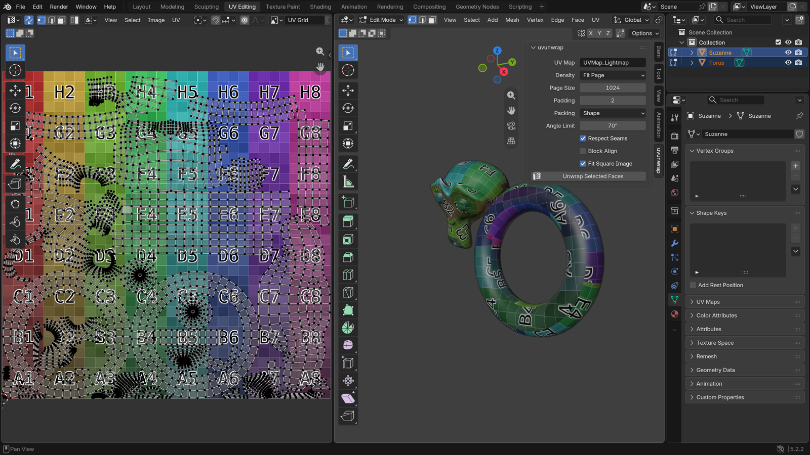

# uvunwrap for Blender

Automatic UV unwrapping for lightmaps, baking and texture atlases, powered by
[uvunwrap](https://github.com/archonic/uvunwrap) (Rust). On six standard
test models it packs 1–17 percentage points more of the page than Blender's
Smart UV Project + Pack Islands at the same padding and runs 21–350× faster;
it never folds or overlaps triangles, and every chart keeps a uniform texel
density.



## Install

Blender 4.2 or later. Download the zip for your platform from the
[releases](https://github.com/archonic/uvunwrap-blender/releases), then in
Blender: **Edit → Preferences → Get Extensions → ⌄ → Install from Disk**.

## Use

- **Object Mode:** select one or more mesh objects; they are unwrapped into
  one shared atlas, in world space, so texel density matches across objects.
- **Edit Mode:** only the selected faces are unwrapped; other faces keep
  their UVs.

Run **Unwrap with uvunwrap** from the UV menu (`U` in Edit Mode) or the
**uvunwrap** tab of the sidebar (`N`), which also holds the settings. The
result goes into a UV map (`UVMap_Lightmap` by default, created if missing);
the mesh itself is never changed. Large meshes unwrap in the background with
a progress bar; `Esc` cancels.

Quads and n-gons stay whole, and marked seams become chart boundaries.

| Setting | |
|---|---|
| UV Map | The UV map to write. |
| Density | **Fit Page**: the highest density that fits one page. **Fixed**: a set number of texels per meter, spilling onto UDIM tiles when one page isn't enough. |
| Page Size | Page width and height in texels. |
| Padding | Empty texels around each chart, against bleeding. |
| Packing | **Shape**: densest. **Fast**: milliseconds for thousands of charts. |
| Angle Limit | Maximum angle between a face and its chart's average normal. |
| Respect Seams | Marked seams become chart boundaries. |
| Block Align | Whole 4×4 texel blocks per chart, for BC/ASTC compression. |
| Fit Square Image | Scale a page shorter than it is wide into a square image. |

## Development

```sh
python scripts/fetch_wheels.py      # the uvunwrap wheels into extension/wheels
blender --command extension build --source-dir extension --output-dir dist --split-platforms
blender -b --factory-startup --python-exit-code 1 \
    --python tests/test_extension.py -- --wheels <dir with the uvunwrap package>
```

The tests run inside Blender. With `--wheels` (e.g. an unpacked wheel, or a
`pip install --target` directory) they load the extension from this
checkout; without it, the installed extension (`bl_ext.user_default.uvunwrap`).

## License

GPL-3.0-or-later. The bundled uvunwrap wheels are MIT.
